# COROC Escritorio para Windows

COROC Escritorio es **un solo programa** que se instala con doble clic y guarda todo **dentro de su PC**: clientes,
préstamos, pagos, recibos y comprobantes. No necesita nube, ni Docker, ni pago mensual, ni saber de sistemas.

**Qué necesita**
- Un PC con **Windows 10 u 11 de 64 bits**, con 4 GB de memoria o más y 2 GB libres en el disco.
- Su **cuenta de Windows con contraseña o PIN**: sus datos solo se abren desde esa cuenta.
- **Internet** para descargar COROC, para el correo de Gmail y para WhatsApp. Lo demás funciona sin internet.
- **WhatsApp para Windows** (gratis, en Microsoft Store), vinculado con su celular.

---

## 1. Descargar e instalar (unos 2 minutos)

1. Entre a **https://github.com/aboteroproyectos/coroc/releases** y abra la más reciente que se llame
   **COROC Escritorio para Windows**.
2. En **Assets**, descargue **COROC-Escritorio-Windows.exe** (pesa unos 110 MB).
3. Abra el archivo con doble clic.
4. Si Windows muestra **«Windows protegió su PC»**, toque **Más información** y después **Ejecutar de todas formas**.
   - Aparece porque el instalador todavía no tiene firma digital. Es normal con programas nuevos y desaparece cuando
     COROC tenga su certificado.
   - Descargue COROC solo desde la página de arriba.
5. Toque **Instalar**. No hay nada que elegir y no hace falta ser administrador. Al final deje marcado **Abrir COROC**
   y toque **Finalizar**. Queda el acceso **COROC** en el escritorio y en el menú Inicio.

## 2. La primera vez: 5 pasos cortos

Al abrir, COROC se enciende solo. La primera vez tarda un poco más, porque prepara la base de datos de su empresa.

**Paso 1 · Su empresa.** Escriba el nombre de la empresa y elija el país: Colombia (pesos), Brasil (reales) o Estados
Unidos (dólares). Arriba a la derecha puede cambiar el idioma (español, portugués o inglés).

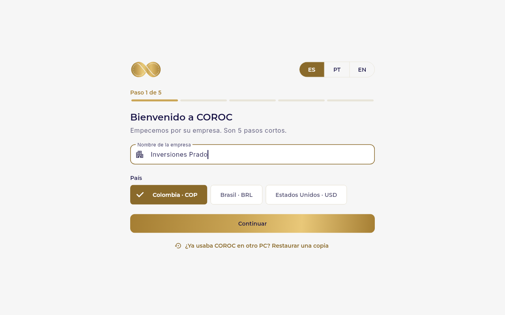

**Paso 2 · Usted, el Propietario.** Su nombre, el usuario con el que va a entrar y una contraseña de al menos 12
caracteres (una frase fácil de recordar sirve muy bien).
- Marque **Abrir COROC con Windows Hello** para entrar con su rostro, su huella o el PIN del PC, sin escribir la
  contraseña.
- La verificación en dos pasos es opcional en este PC; puede activarla después en Configuración.
- Toque **Crear mi empresa**.

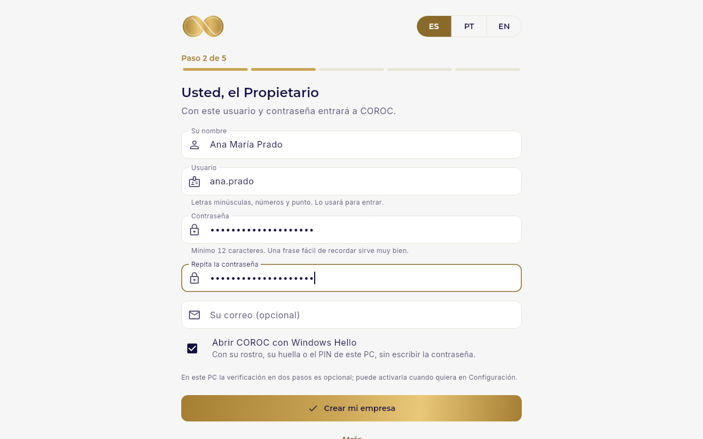

**Paso 3 · Tasas de interés.** Es opcional.
- En Colombia puede registrar el tope legal (la tasa de usura) con **Registrar tope**. COROC le avisa antes de pasarlo.
- **Permitir préstamos por encima del tope:** solo si usted lo decide. Lea la advertencia legal y acéptela una sola vez.
  Después, cada préstamo por encima del tope se guarda marcando **«Confirmo este préstamo por encima del tope legal»**.

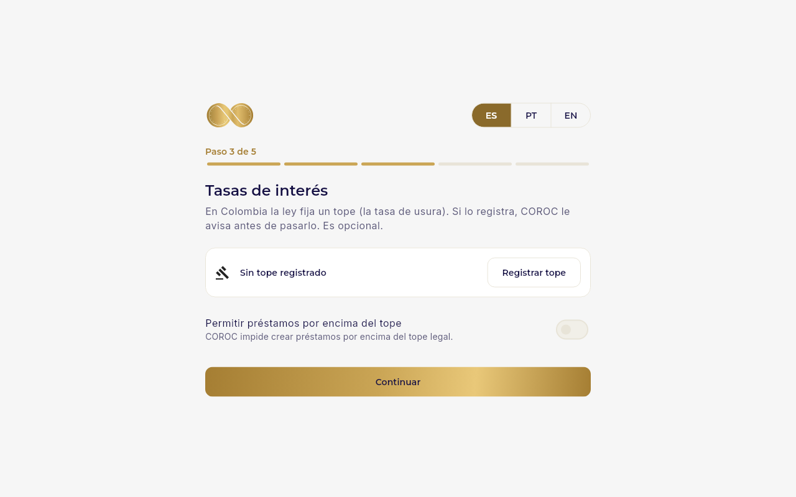

**Paso 4 · El Gmail de la empresa.** Con él, COROC lee los comprobantes que sus clientes le envían por correo y les
responde con el recibo. No se usa su contraseña de Gmail, sino una **contraseña de aplicación** de 16 letras:
1. Toque **Abrir la página de Google**. En su cuenta de Google active la **Verificación en 2 pasos** si aún no la tiene.
2. En **Contraseñas de aplicaciones**, escriba `COROC` y toque **Crear**.
3. Copie las 16 letras que muestra Google, péguelas en COROC y toque **Probar la conexión**.

Si algo falta, COROC le dice qué es. Si prefiere hacerlo después, toque **Omitir por ahora**: queda en **Configuración ›
Correo de la empresa (Gmail)**.

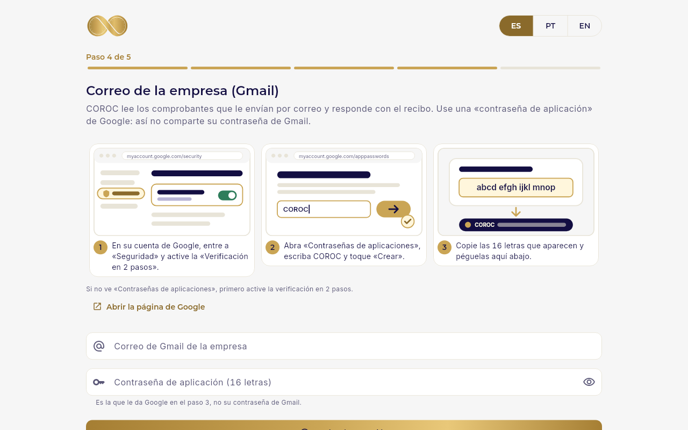

**Paso 5 · WhatsApp.** COROC revisa si WhatsApp para Windows está instalado. Si falta, toque **Abrir Microsoft Store**,
instálelo, vincúlelo con el código QR que muestra su celular y toque **Ya lo instalé**. Su número no se conecta a
ningún programa: COROC prepara cada mensaje y usted lo envía.

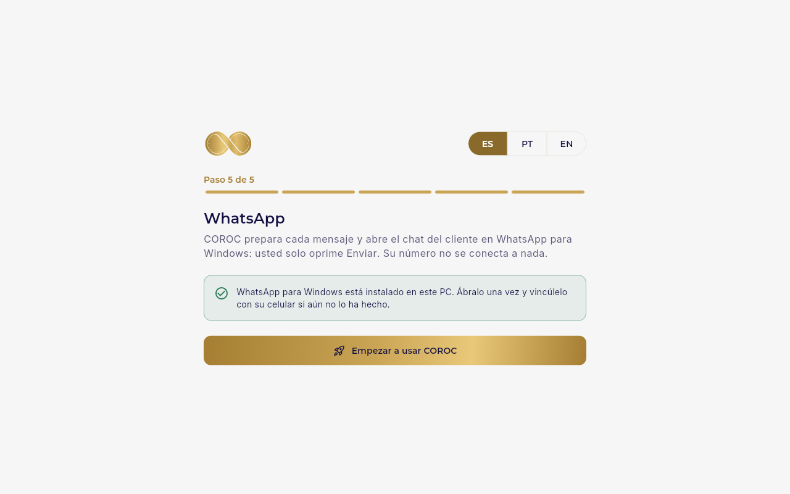

Toque **Empezar a usar COROC**. Un recorrido corto le muestra lo principal; puede saltarlo.

### ¿Ya usaba COROC en otro PC?

En la primera pantalla toque **¿Ya usaba COROC en otro PC? Restaurar una copia**. Elija el archivo `.coroc` (de
OneDrive, Google Drive o una memoria USB), escriba la contraseña de esa copia y toque **Restaurar en este PC**. Al
terminar, entre con su usuario y su contraseña de siempre.

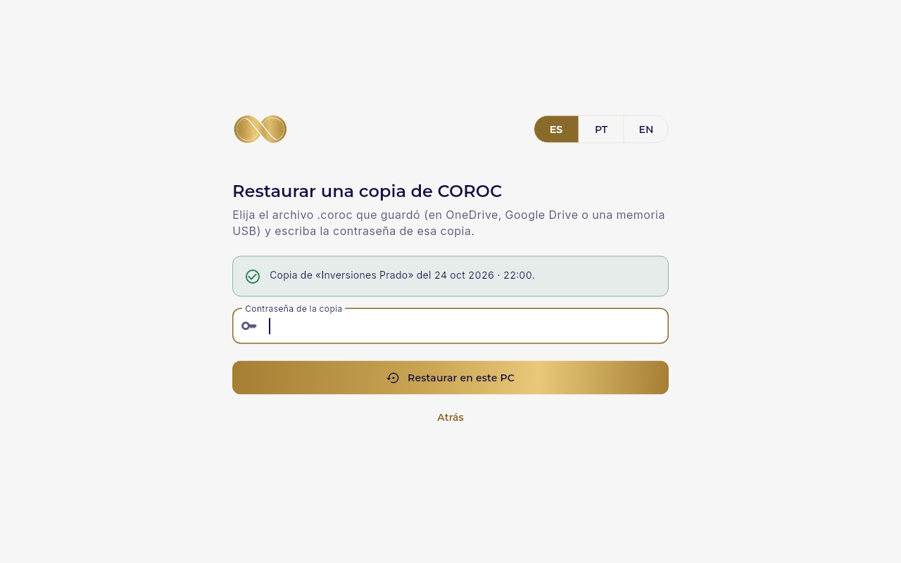

## 3. El día a día

### Abrir y cerrar

- **Abrir:** doble clic en **COROC** en el escritorio. Si eligió Windows Hello, confirme con su rostro, su huella o su PIN.
- **Cerrar la ventana no apaga COROC:** queda junto al reloj de Windows, abajo a la derecha, y sigue leyendo el correo
  y preparando los recordatorios. Para volver, toque el ícono de COROC.
- **Salir del todo:** clic derecho en el ícono de COROC junto al reloj › **Salir de COROC**.
- **Apagar el PC:** como siempre. Para que COROC se abra solo al encender el PC, active **Configuración › Este PC ›
  Iniciar COROC con Windows**.

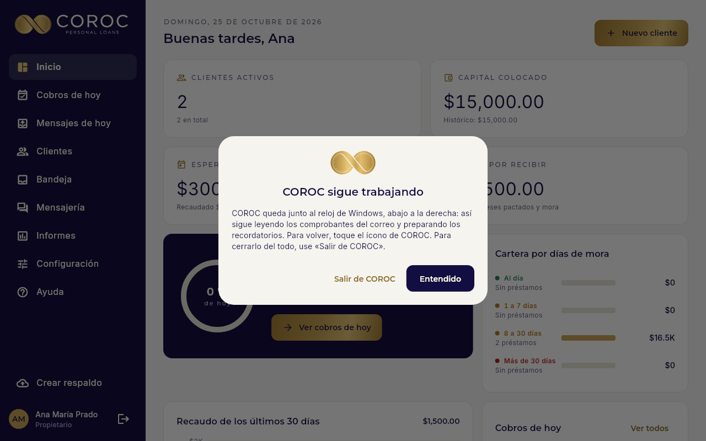

### Mensajes de hoy por WhatsApp

COROC prepara los recordatorios, avisos de atraso, recibos y paz y salvos del día, respetando las franjas y los
límites de la Ley 2300. En el menú, **Mensajes de hoy** los muestra uno a la vez:

1. Toque **Enviar por WhatsApp**. Se abre el chat del cliente en WhatsApp con el mensaje escrito.
2. Si el mensaje lleva el recibo en PDF, COROC ya lo copió: en WhatsApp oprima **Ctrl+V**.
3. Oprima **Enter** en WhatsApp y vuelva a COROC: pasa solo al siguiente («3 de 12»).

Si un mensaje no puede salir a esa hora, COROC dice por qué y lo deja para después.

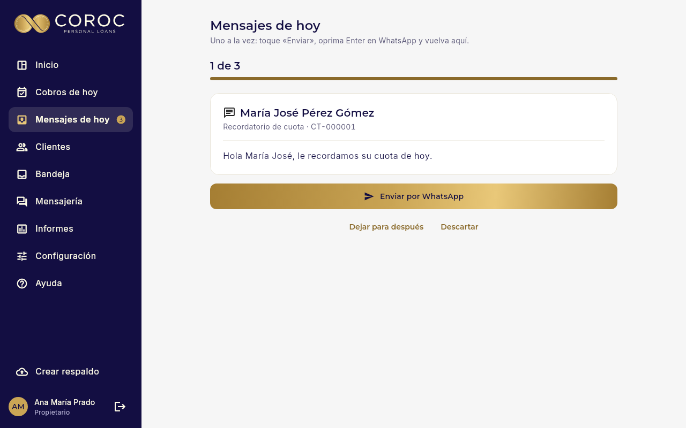

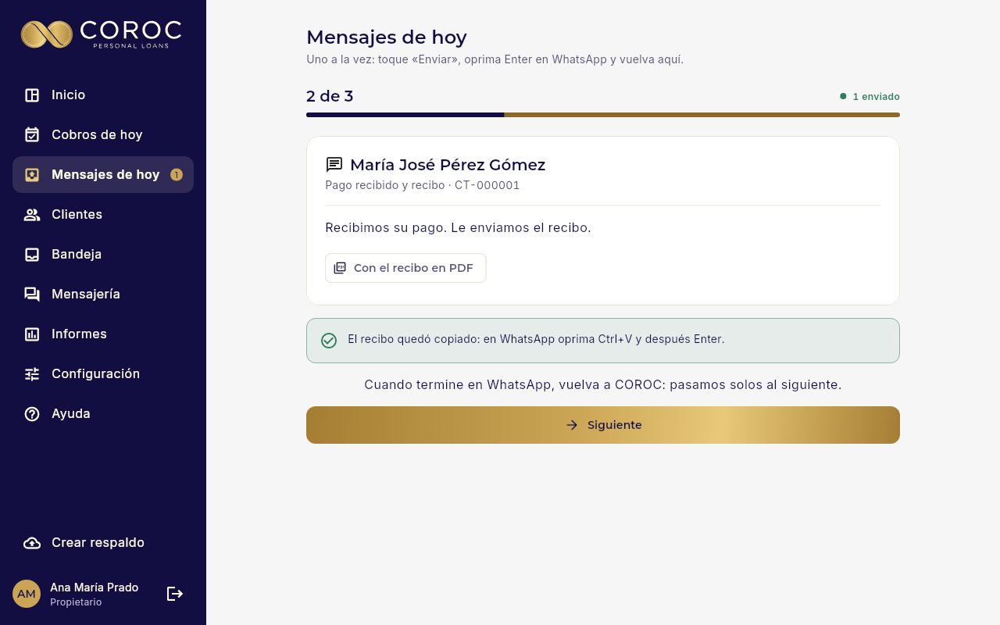

### Recibir comprobantes

Cuando un cliente le manda la foto del pago por WhatsApp, llévela a COROC de cualquiera de estas formas:

- **Arrástrela** desde WhatsApp y suéltela en cualquier parte de COROC.
- En WhatsApp, clic derecho en la imagen › **Copiar**, y en COROC oprima **Ctrl+V**.
- Si la guarda en **Descargas**, COROC le pregunta **«¿Es un comprobante?»**: toque **Sí, registrarlo**.

COROC lee el valor, la fecha y la referencia, busca al cliente y registra el pago, o se lo propone en la **Bandeja**
para que lo apruebe. Con el pago registrado, toque **Enviar el recibo** y WhatsApp se abre con el mensaje y el PDF
listos.

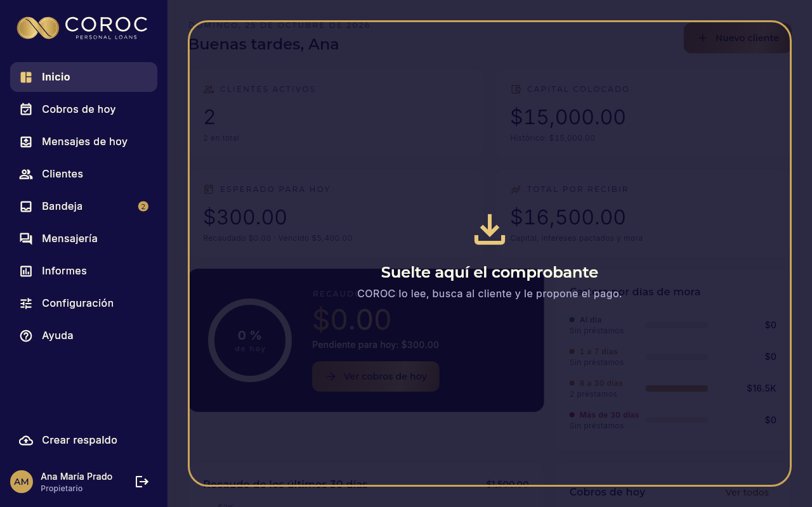

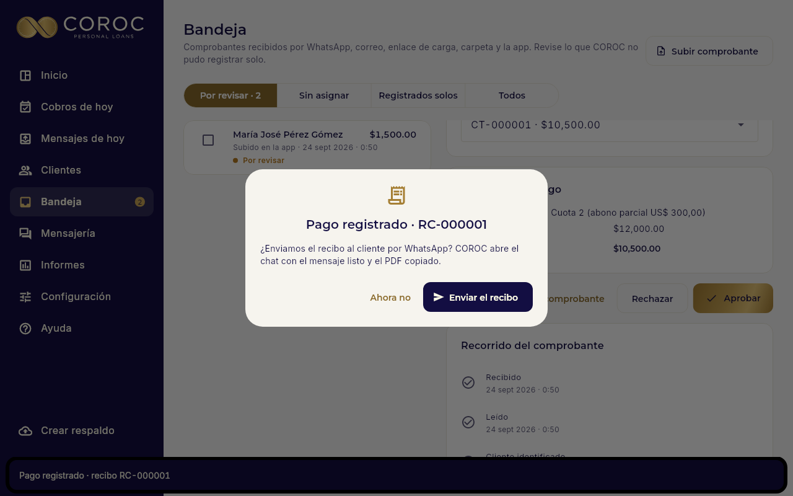

### El correo de Gmail

Con Gmail conectado no tiene que hacer nada:
- si un cliente envía un comprobante a su correo, COROC lo lee, registra o propone el pago, le responde con el recibo
  en el mismo correo y lo marca en Gmail con la etiqueta **COROC/Procesado**;
- COROC solo abre los correos de sus clientes;
- en la ficha de cada cliente, pestaña de mensajes, está el hilo de correos con él.

Gmail permite unos 500 correos al día; COROC usa hasta 400 y deja los demás para el día siguiente.

## 4. Sus datos, a salvo

Todo queda en este PC. Si el disco se daña o el PC se pierde, la copia diaria es lo que lo salva.

**Configúrela el primer día** en **Configuración › Copia diaria automática**:
1. **Elegir la carpeta:** una carpeta dentro de **OneDrive** o de **Google Drive para escritorio** (así la copia
   queda también en la nube) o una memoria USB que deje conectada.
2. **Contraseña de las copias:** mínimo 10 caracteres. **Anótela en un lugar seguro:** sin ella la copia no se abre.
3. **Copias que se guardan:** cuántas conservar en la carpeta (por ejemplo, 14).

Cada día COROC guarda ahí una copia cifrada. Si pasan 7 días sin copia, le avisa arriba de la pantalla. También puede
tocar **Hacer una copia ahora** cuando quiera.

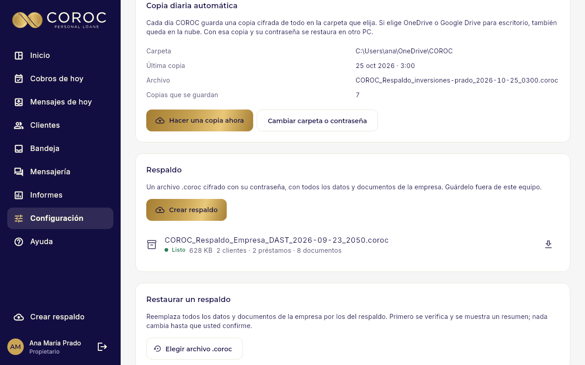

**Para pasar a otro PC:** instale COROC allí y restaure la última copia (ver «¿Ya usaba COROC en otro PC?»).

## 5. Actualizar COROC

Descargue el instalador nuevo de la misma página y ábralo. COROC se cierra solo, guarda antes una copia de la base de
datos y se actualiza. Sus datos quedan intactos. Si no pudiera guardar esa copia (por ejemplo, por falta de espacio en
el disco), no cambia nada y le dice qué hacer.

## 6. Desinstalar

**Configuración de Windows › Aplicaciones › COROC › Desinstalar.** COROC pregunta si también borra los datos: si
responde **No** (lo recomendado), quedan guardados y COROC los vuelve a usar si lo instala de nuevo.

## 7. Ajustes útiles

- **Tamaño de la letra** (normal, grande o más grande): **Configuración › Tamaño de la letra**.
- **Windows Hello** para abrir COROC: **Configuración › Este PC**.
- **Preguntar por los comprobantes que llegan a Descargas:** **Configuración › Este PC**.
- **Ayuda**, en el menú: guías cortas en español, portugués e inglés.

## 8. Si algo no funciona

| Qué pasa | Qué hacer |
|---|---|
| «Windows protegió su PC» al instalar | Toque **Más información › Ejecutar de todas formas** (ver el paso 1). |
| «COROC no pudo arrancar» | Toque **Reintentar**. Si sigue igual, reinicie el PC y abra COROC. Sus datos están a salvo. |
| «Falta una parte de COROC en este PC» | Vuelva a abrir el instalador de COROC. Sus datos se conservan. |
| «La base de datos no encendió» | Reinicie el PC y abra COROC. Si sigue igual, toque **Copiar el código para soporte** y envíelo. |
| Olvidé mi contraseña | En la pantalla de ingreso toque **¿Olvidó su contraseña?**, confirme con Windows Hello y elija una nueva. Sin Windows Hello, otro Propietario puede asignarle una. |
| WhatsApp no se abre al tocar «Enviar» | Abra WhatsApp para Windows una vez y revise que esté vinculado con su celular. |
| Gmail «Con un problema» | En **Configuración › Correo de la empresa (Gmail)** COROC dice qué pasó. Casi siempre basta **Poner una nueva contraseña de aplicación**. |
| «No se encontró la carpeta de las copias» | Si es una memoria USB, conéctela. Si no, elija otra carpeta en Configuración › Copia diaria automática. |
| No veo COROC en la pantalla | Está junto al reloj de Windows (puede estar dentro de la flechita ^). Tóquelo para abrirlo. |

## 9. Qué hace y qué no hace COROC Escritorio

| Hace | Necesita la nube ([GUIA_PUESTA_EN_MARCHA.md](GUIA_PUESTA_EN_MARCHA.md)) |
|---|---|
| Clientes, préstamos, pagos, recibos y paz y salvos en PDF, informes | Cobradores que trabajan desde su celular |
| Leer los comprobantes que usted arrastra, pega o recibe por Gmail | Enlace para que el cliente suba su comprobante desde su celular |
| Mensajes del día por WhatsApp (usted oprime Enviar) y correos por Gmail | WhatsApp automático, sin oprimir Enviar (Cloud API) |
| Copia diaria cifrada en OneDrive, Google Drive o USB | |

Para pasar a la nube más adelante no hay que volver a digitar nada: se crea la empresa en la nube y se restaura la
copia `.coroc` en **Configuración › Respaldo › Restaurar**.

---

**Para quien da soporte.** Programas en `%LOCALAPPDATA%\COROC\app` y `\servidor`; datos en `%LOCALAPPDATA%\COROC\datos`
(base `pg`, `archivos`, `secretos.bin` con DPAPI, `registros` sin datos personales y `respaldos-previos`). Decisiones:
ADR-062 a ADR-067 en [DECISIONES.md](DECISIONES.md); construcción y CI en
[06_EJECUCION_Y_DESPLIEGUE.md](06_EJECUCION_Y_DESPLIEGUE.md) §7. El paquete con Docker
([GUIA_PC_WINDOWS.md](GUIA_PC_WINDOWS.md)) queda solo para soporte.
